# AISafe Flight Management System — versão distribuída

SIDIS · Assignment 1 · LETI · ISEP
Grupo: Gustavo Campos (1231051) e Diogo Kolmer (1230426)

O monólito AISafe desenvolvido em PSOFT (na raiz do repositório, mantido inalterado como referência) foi dividido em **cinco serviços Spring Boot independentes**, cada um com **duas réplicas**, base de dados própria por réplica, forwarding e agregação entre réplicas, e segurança entre serviços.

| Serviço | Contexto (DDD) | Réplicas | Responsável |
|---|---|---|---|
| `auth-service` | Identity & Access (genérico) | 8051 / 8052 | Gustavo Campos |
| `airport-service` | Airport Management (suporte) | 8091 / 8092 | Gustavo Campos |
| `maintenance-service` | Maintenance Management (core) | 8061 / 8062 | Gustavo Campos |
| `Aircraft_Service` | Aircraft Management (core) | 8081 / 8082 | Diogo Kolmer |
| `route_flight_service` | Route / Flight Operations (core) | 8071 / 8072 | Diogo Kolmer |

- **Como correr e testar:** [`COMO-CORRER.md`](COMO-CORRER.md) (certificados, arranque das réplicas, Postman, utilizadores, guião de demonstração, problemas comuns).
- **Justificação DDD e decisões detalhadas:** [`docs/justificacao_ddd.md`](docs/justificacao_ddd.md).
- **Testes end-to-end:** coleções Postman em [`tests/postman/`](tests/postman/).

---

## 1. Arquitetura (C4)

### 1.1 Contexto do sistema (C4 nível 1)
Os utilizadores (Backoffice, ATCC, técnicos e supervisores de manutenção, administrador) usam o AISafe por HTTPS/REST, autenticados com JWT. Não há sistemas externos.

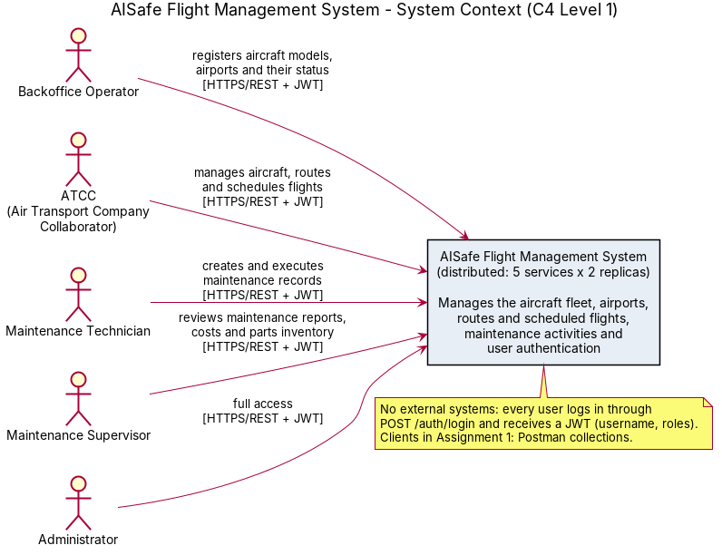

### 1.2 Mapa de contextos DDD
Quatro contextos de negócio e um subdomínio genérico de identidade. As setas vão do consumidor para o fornecedor; o grafo é acíclico: `aircraft-service` e `airport-service` não chamam nenhum outro serviço.

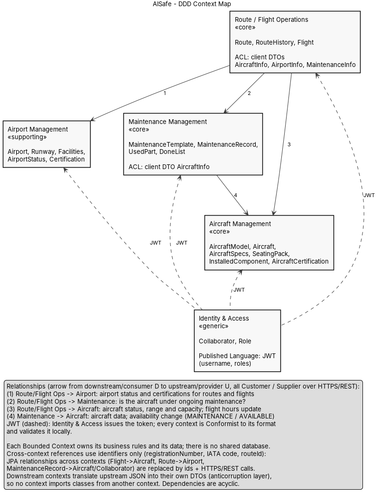

### 1.3 Containers (C4 nível 2)
Cada contexto é um processo Spring Boot com a sua base H2. Os serviços comunicam apenas por REST síncrono; não há base de dados partilhada nem filas de mensagens.

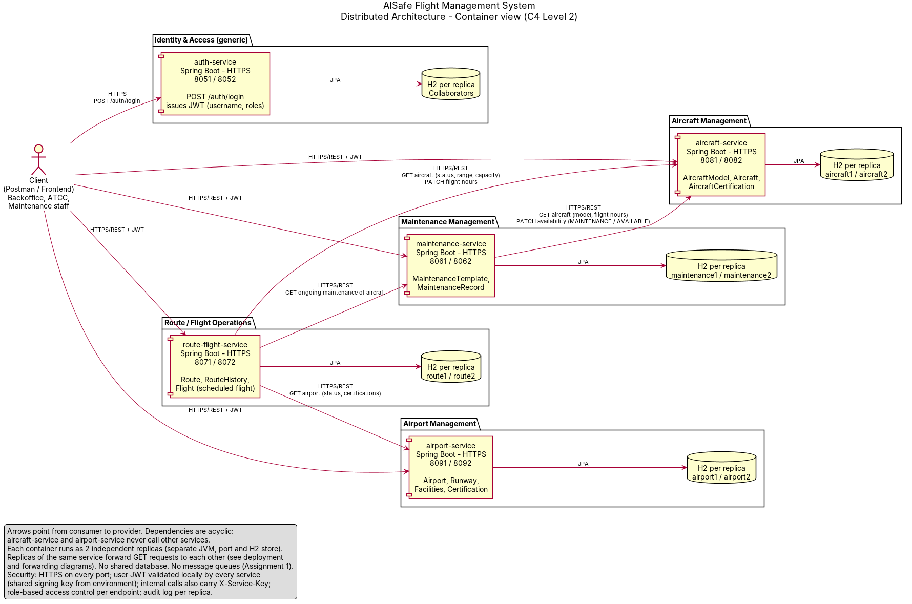

### 1.4 Logical View (UML): classes do domínio de cada serviço
As relações JPA que no PSOFT atravessavam contextos (`Flight → Aircraft`, `Route → Airport`, `MaintenanceRecord → Aircraft/Collaborator`) foram substituídas por identificadores (matrícula, código IATA, `routeId`, `username`).

| auth-service | maintenance-service |
|---|---|
| 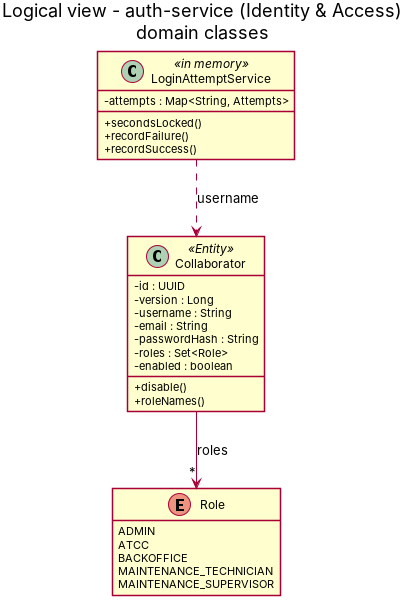 | 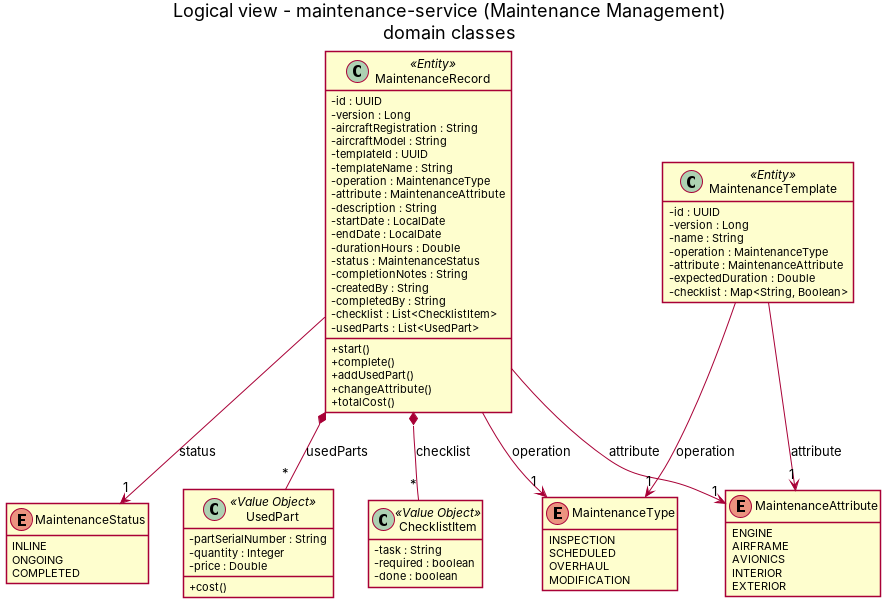 |

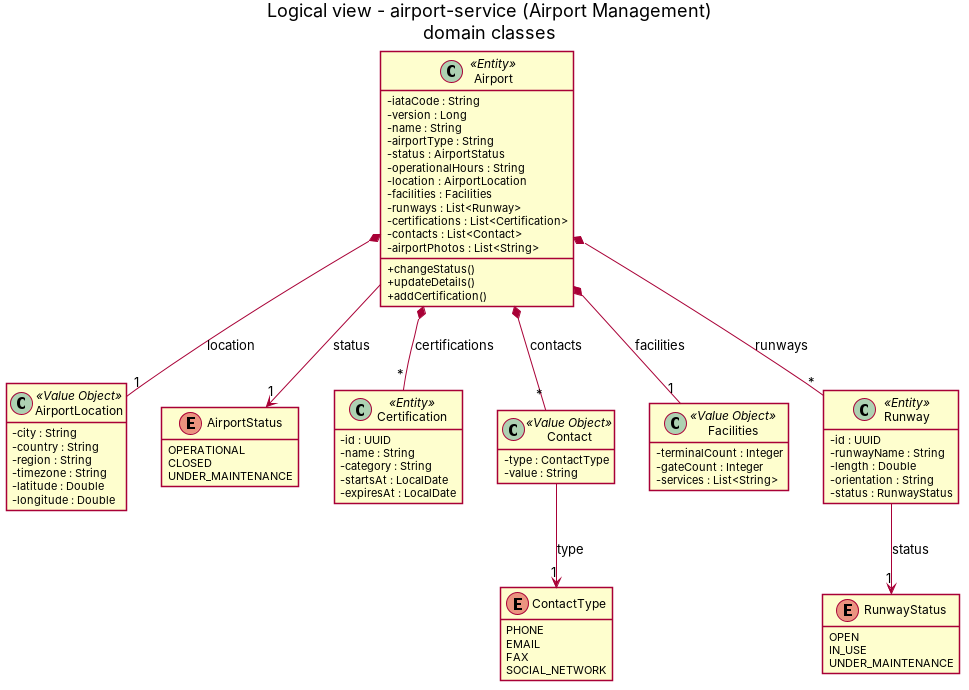

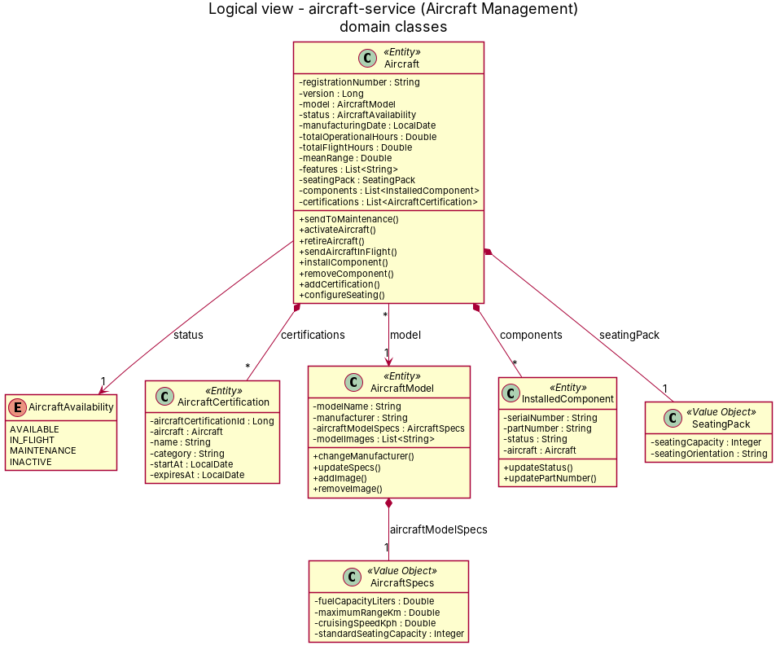

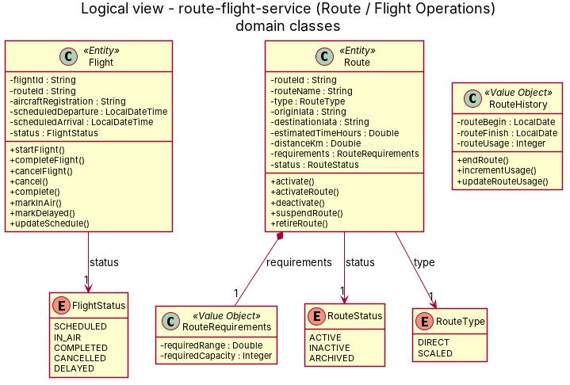

### 1.5 Physical View: deployment e replicação
10 processos (5 serviços × 2 réplicas), um perfil Spring por réplica (`instance1` / `instance2`), cada um com porta e H2 próprios.

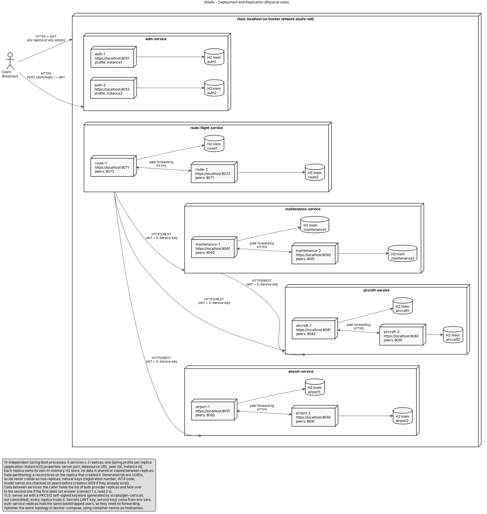

### 1.6 Cenários principais (sequência)
**Forwarding de GET e agregação, incluindo falha do peer:**

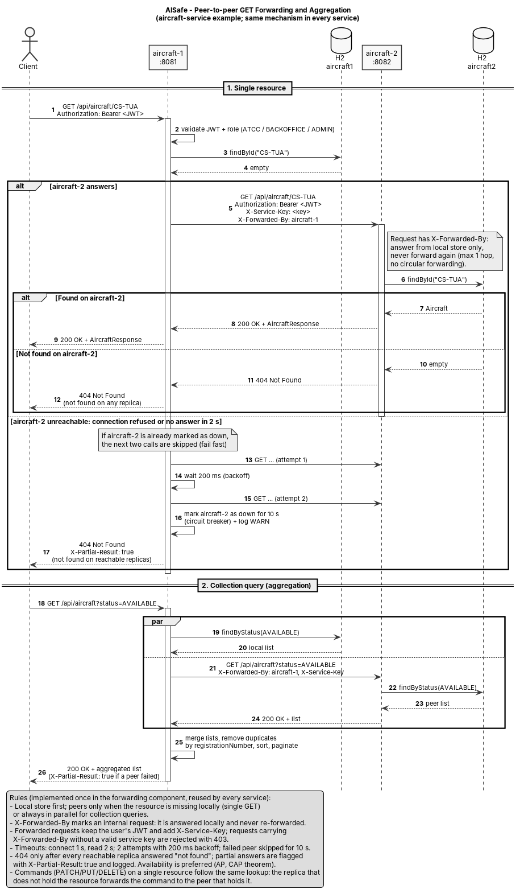

**Agendamento de um voo com colaboração entre serviços (US212):**

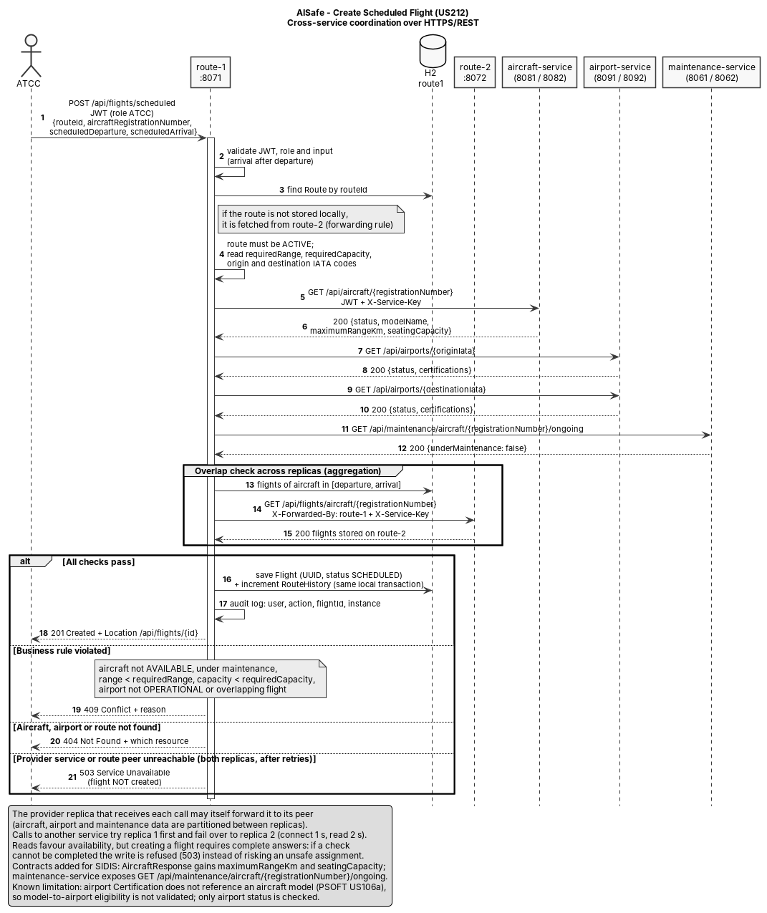

---

## 2. Decisões de arquitetura

**Divisão em serviços.** Seguimos os Bounded Contexts do domínio em vez da proposta de três serviços do enunciado: Aircraft e Maintenance ficam separados porque têm regras, ciclos de vida e utilizadores diferentes (ATCC vs. técnicos), e Route e Flight ficam juntos porque agendar um voo atualiza o histórico da rota na mesma transação local. A identidade foi isolada num serviço genérico para não misturar utilizadores com os contextos de negócio.

**Replicação e particionamento.** Cada réplica tem a sua base H2 e os dados ficam na réplica que os criou; os ids gerados são UUID para não colidirem. As chaves naturais (matrícula, código IATA) são verificadas nas duas réplicas antes de criar (409 se já existirem). Os utilizadores do `auth-service` são dados de referência carregados igualmente nas duas réplicas.

**Forwarding e agregação.** Uma réplica procura primeiro localmente; se não encontrar, pergunta ao peer com `X-Forwarded-By`, e um pedido reencaminhado nunca volta a ser reencaminhado (no máximo 1 salto, sem ciclos). Os comandos sobre um recurso existente também vão para a réplica dona. As listas e os relatórios juntam os dados das duas réplicas, sem duplicados. As respostas indicam quem respondeu (`X-Served-By`), de onde vieram os dados (`X-Data-Source`) e se estão incompletas (`X-Partial-Result`).

**Tolerância a falhas.** Timeouts de 1 s (ligação) e 2 s (leitura), 2 tentativas com 200 ms de backoff, circuit breaker de 10 s por peer e failover para a segunda réplica nas chamadas entre serviços.

**Consistência (AP).** Privilegiamos a disponibilidade: se um peer falha, a réplica responde com os dados que tem e marca a resposta como parcial. Operações que precisam de todas as verificações (agendar voos, criar registos de manutenção que validam a aeronave) são recusadas com 503 em vez de arriscar dados errados. A atualização do estado da aeronave pela manutenção é feita em melhor esforço e indicada no campo `aircraftSync`.

**Segurança.** HTTPS em todas as réplicas (certificado gerado por `scripts/gen-certs.*`, nunca guardado no git); JWT emitido pelo `auth-service` e validado localmente por cada serviço com a chave partilhada (os serviços não dependem do auth em cada pedido); `X-Service-Key` nas chamadas internas e nos pedidos reencaminhados; RBAC por endpoint; passwords com BCrypt e bloqueio após 5 logins falhados (429); log de auditoria por réplica.

---

## 3. Testes

Coleções Postman em `tests/postman/`, com login automático (os tokens ficam nas variáveis da coleção) e cenários de acesso local, forwarding, agregação, segurança e falha. As pastas de falha correm-se depois de parar a réplica ou o serviço indicado.

| Coleção | Resultado com o sistema completo |
|---|---|
| auth-service | 36 / 36 testes |
| airport-service | todos os testes das pastas 00–4; pasta 5 com o airport-2 parado |
| maintenance-service | todos os testes das pastas 00–5 (80 / 80); pastas 6 e 7 com a maintenance-2 ou o aircraft-service parados |

Os serviços `auth`, `airport` e `maintenance` têm também testes unitários do domínio (`mvn test`).

### Capturas do sistema a correr

**auth-service:** corrida da coleção (bloqueio com 429 no fim) e login dos vários papéis.

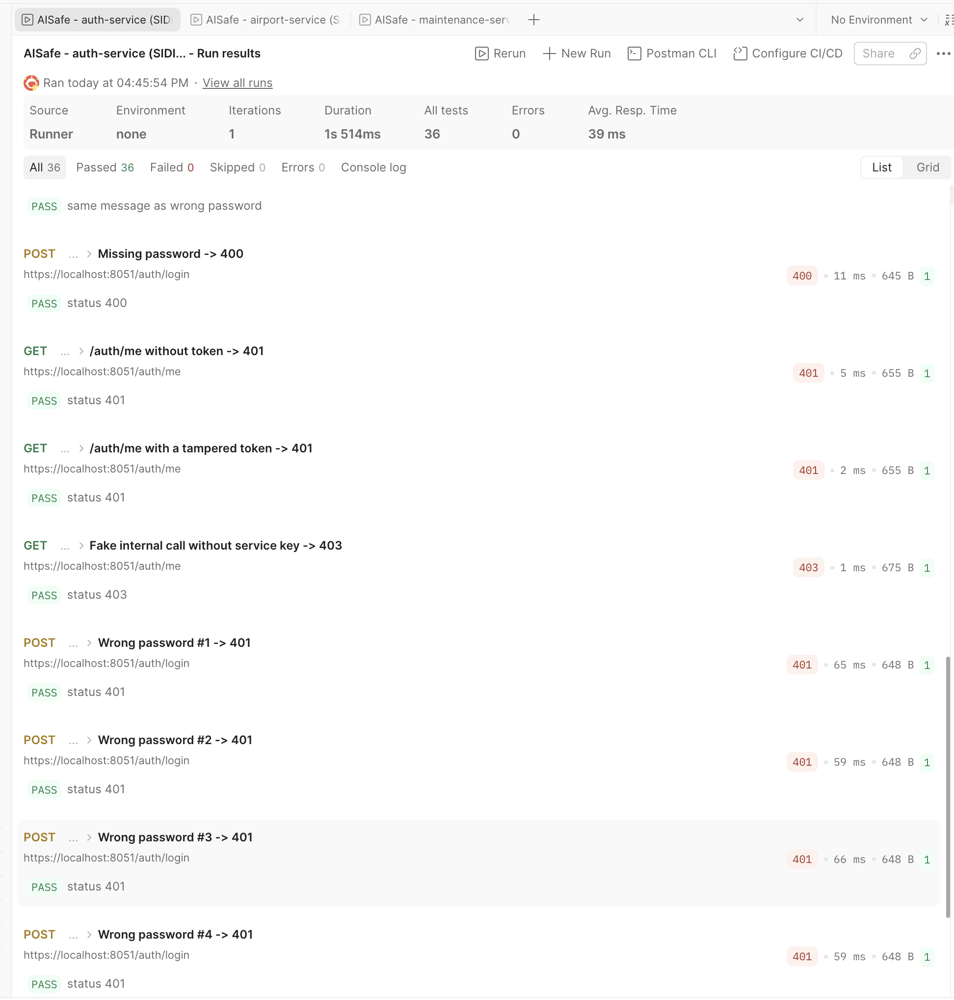
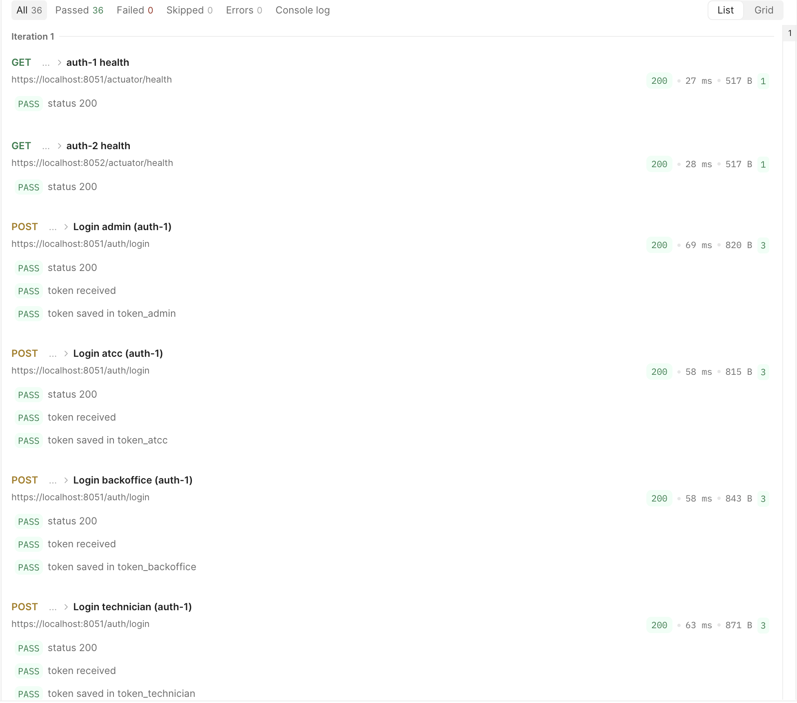

**airport-service:** forwarding e agregação entre réplicas; comandos reencaminhados e 409 entre réplicas.

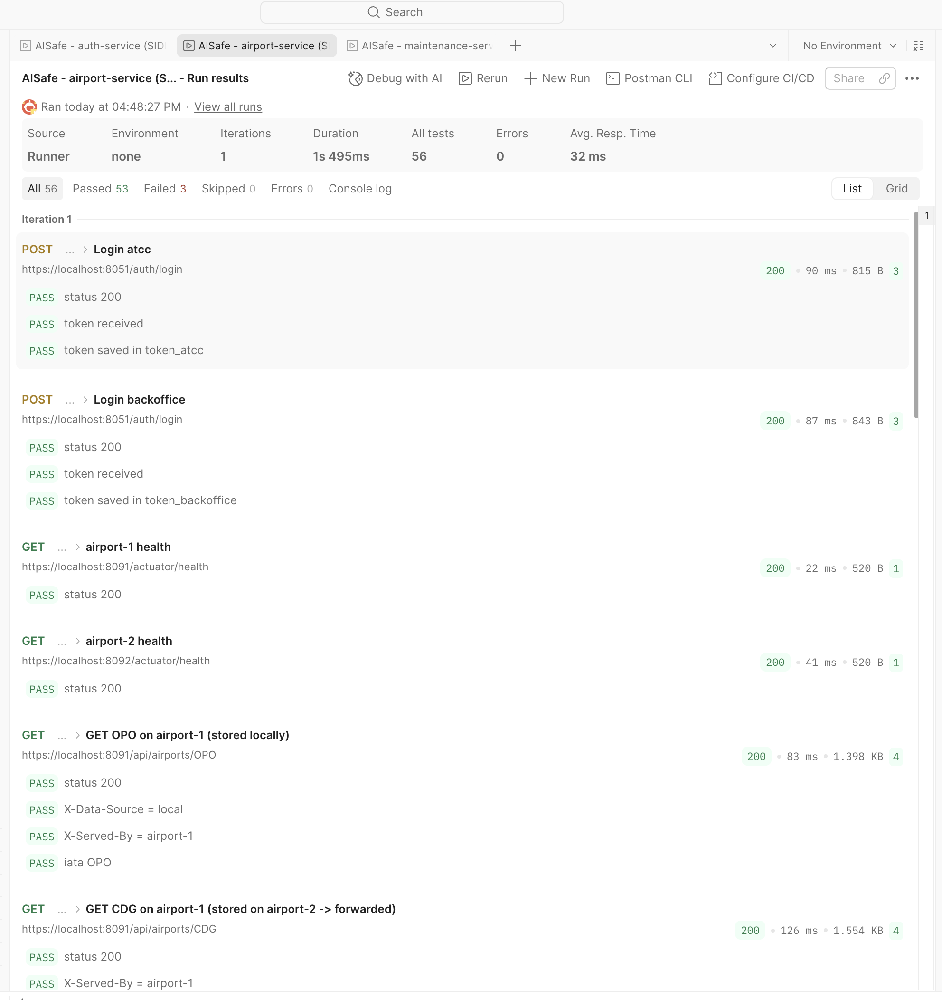
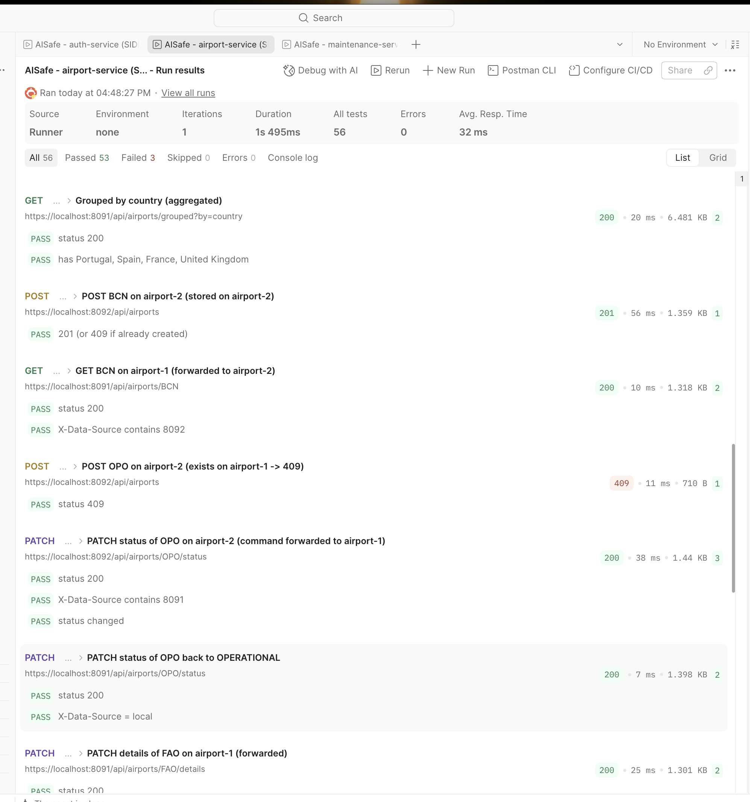

**maintenance-service:** corrida da coleção com o aircraft-service ligado (as 5 falhas são das pastas de falha, que exigem parar serviços).

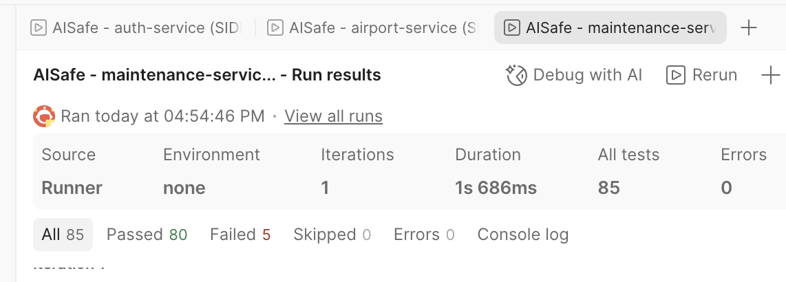

**aircraft-service:** criar aeronave, mudar o estado e pedido sem autenticação recusado (401).

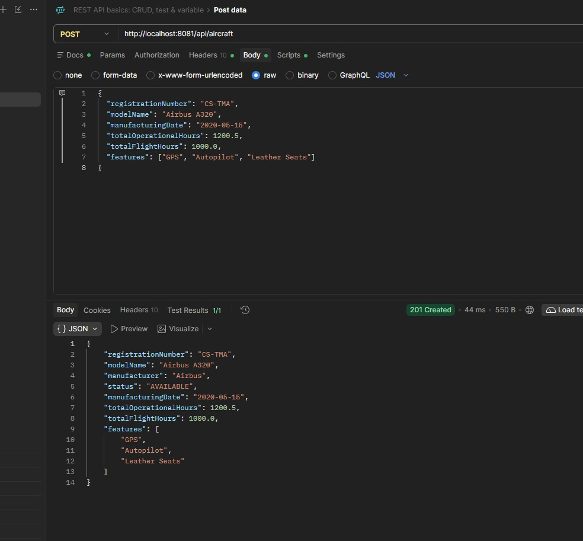
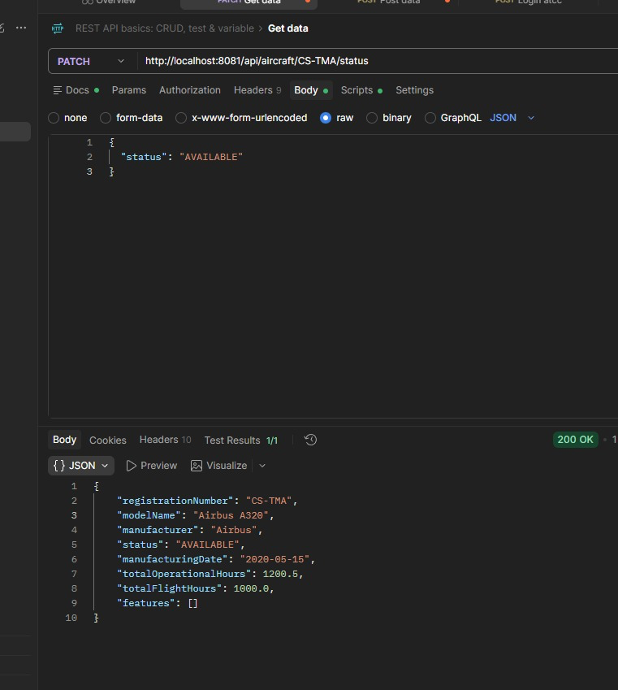
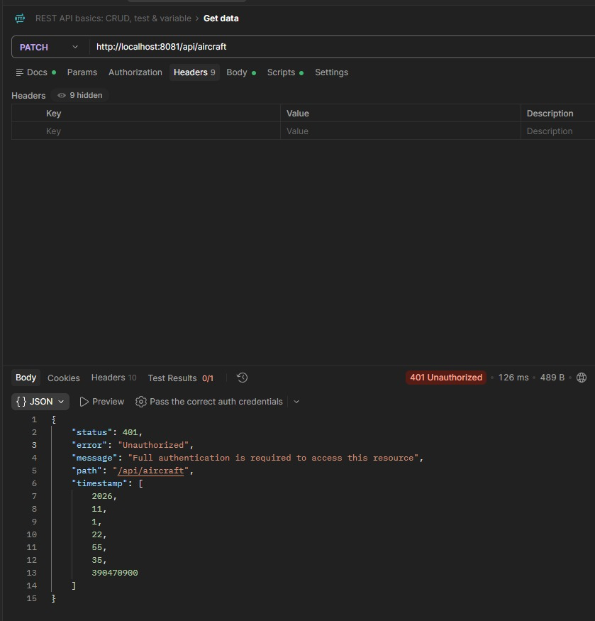

**route-flight-service:** criar rota e cancelar voo.

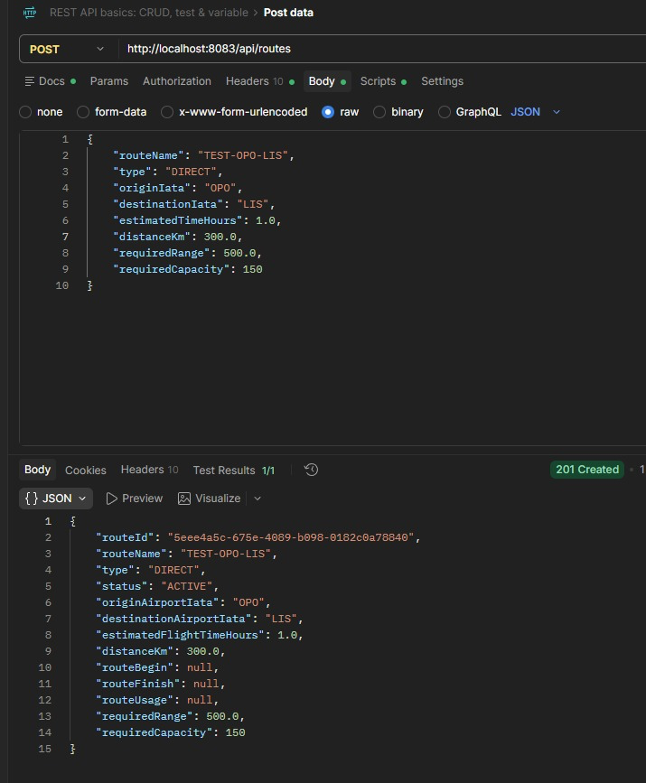
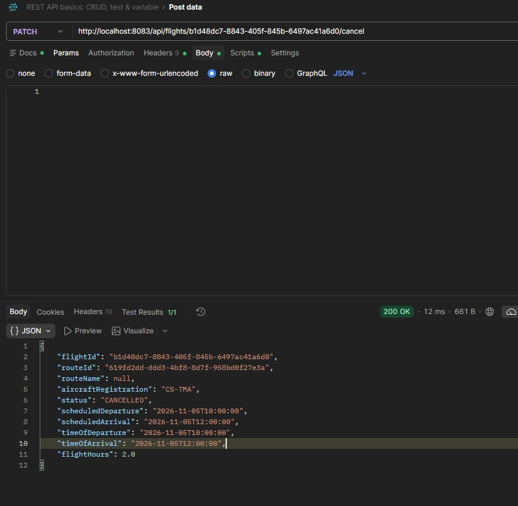

---

## 4. Limitações conhecidas

- As bases H2 são em memória: uma réplica que reinicie perde o que foi criado nela (o bootstrap volta a ser carregado).
- Os dados não são copiados entre réplicas: se uma réplica estiver em baixo, os dados que só ela tem ficam indisponíveis e as respostas vêm marcadas como parciais.
- O bloqueio de login é guardado por réplica do `auth-service`.
- Se o `aircraft-service` estiver em baixo quando uma manutenção começa ou acaba, o estado da aeronave fica desatualizado até à operação seguinte.
- A `Certification` do aeroporto (PSOFT) não identifica um modelo de aeronave, por isso a elegibilidade modelo–aeroporto não é validada no agendamento.
- `Aircraft_Service` e `route_flight_service`: à data da entrega correm em HTTP nas portas indicadas nos seus perfis e ainda não partilham a chave JWT e a chave de serviço dos outros três serviços; a integração completa route ↔ airport/aircraft fica por concluir.
